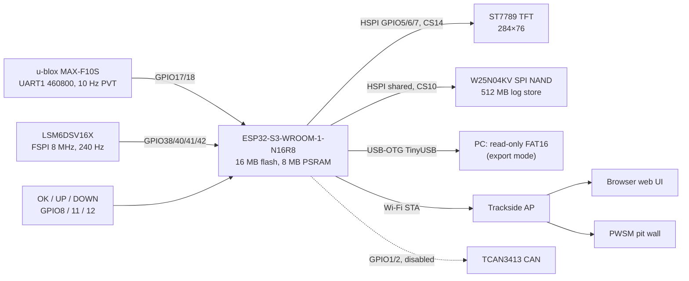
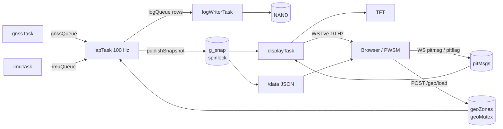

# Agile Architecture (firmware v0.17.0)

## Block diagram

## Firmware tasks (FreeRTOS)

| Task | Core | Prio | Rate | Role |
|---|---|---|---|---|
| `gnss` | 0 | 3 | 20 ms | Drain autoPVT, measured rate and worst gap, latest fix to `gnssQueue` |
| `imu` | 0 | 3 | 200 Hz | Read IMU, mounting remap, gravity trim, yaw offset, IIR, levelling |
| `lap` | 0 | 4 | 100 Hz | Buttons, geofence/car state, S/F crossing, recon/racing state machine, live delta, sectors, logging, snapshot |
| `logw` | 0 | 1 | queue | Only NAND writer: packs rows into 2 KB pages |
| `disp` | 1 | 2 | 20 Hz | Owner stack, TFT rendering, 10 Hz WebSocket `live` push |
| `wifi` | 0 | 1 | 2 s | Connect/retry, starts the web server |
| `can` | 0 | 2 | 20 ms | Compiled out (`CAN_ENABLED 0`) |
| AsyncWebServer | lib | – | event | HTTP + `/ws` |

## Timing logic

- **Start/finish** is a two-point line zone (`ZONE_SF_LINE`) in the armed circuit, laid across both the track and the pit lane. A lap triggers when the travel vector between two fixes intersects the line in the learned direction, faster than 10 km/h and at least 15 s after the previous crossing. The crossing time is interpolated along the travel vector. A legacy point S/F (15 m circle) remains as a fallback.
- **Recon lap**: the first lap without a stored map records the trace and IMU events. At the line the events are turned into up to 32 micro-sectors (one per ~150 m of track) and saved to NVS. Next time the unit is within 500 m of that S/F, it offers to reuse the map.
- **Live delta** = elapsed time now − reference elapsed time at the nearest reference point (heading-gated, windowed search). Any faster lap that did not touch the pits becomes the reference by a pointer swap of the PSRAM trace buffers.
- **Geofences** (pit entry/exit lines, pits and fuel polygons) drive the car state. Delta accumulation stops outside `RUNNING` and while stationary. Pitted laps are excluded from best lap and reference, and sectors stay gray until the car rejoins.

Details: [Pseudocode.md](Pseudocode.md). Screens: [Display.md](Display.md). Web: [WebUI.md](WebUI.md). API: [Interface.md](Interface.md).

## Storage

| Where | What |
|---|---|
| NVS `lap_track` | legacy point S/F |
| NVS `lap_best` | all-time best lap |
| NVS `lt_smap` | sector map (packed + CRC32) |
| NVS `lt_geo` | circuits (JSON per name), `_index`, `active` |
| NVS `lt_imu` | roll, pitch, yaw trim |
| NVS `lt_thr` | detection thresholds |
| NVS `pltd-wifi` | Wi-Fi credentials |
| NAND | append-only session logs, one `LOG_nnnn.CSV` per boot |
| PSRAM | reference + current trace (2 × 4500 points) |

Partition table: shared 16 MB dual-OTA ([Firmware/tools/partitions.csv](../Firmware/tools/partitions.csv)).

## Trackside network

Car-side devices on 192.168.0.x (mobile modem / DNA AP). The pit wall reaches the car over the same AP or via WireGuard into the RB3011.
