# PLTD Driver Display (TFT), firmware v0.17.0

The driver display is an ST7789 panel used at **284 × 76 px** (landscape, `setRotation(3)`), driven by `displayTask` on core 1 at 20 Hz. Every screen below was rendered from the firmware's own drawing code by [`Display/render_tft.py`](Display/render_tft.py): same coordinates, strings, colours and text-wrap rules. The font is a monospace stand-in for the Adafruit GFX 5×7 glyphs, so text width and placement match the panel and glyph shapes are approximate. To regenerate, run `python render_tft.py` in `Documentation/Display/`.

Values shown (lap times, satellites, IP, sector colours) are examples.

Contents: [Priority stack](#priority-stack) · [Boot](#boot) · [Diagnostic pages](#boot-diagnostic-pages-down-held-at-power-on) · [USB export](#usb-export-mode-up-held-at-power-on) · [Idle](#idle-screen) · [Recon and approve](#recon-lap-and-approve) · [Racing dash](#racing-dash) · [Car state](#car-state-and-custom-zones) · [Pit board](#pit-board-messages-and-flags) · [Button feedback](#button-hold-feedback) · [Toasts](#toasts) · [Reset](#learned-state-reset) · [OTA](#ota-and-reboot) · [Findings](#display-findings-in-v0170)

## Priority stack

`displayTask` picks one **owner** per frame. The first true condition wins, and an owner change repaints the whole panel.

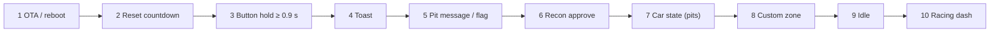

Some consequences of this order:

- A latched YELLOW FLAG covers the racing dash, the approve overlay and the pit-lane screens. It does not cover toasts or button feedback, so the driver still sees that a 10 s IMU reset worked.
- In the pit lane (car state ≠ RUNNING) the delta bar, lap time and sectors are hidden. A pit message still shows over the pit screen.
- During the recon lap the owner is the racing dash, with the bar off (see [Recon lap](#recon-lap-and-approve)).

## Boot

Shown from `setup()` before the tasks start. Each subsystem prints its result on the status line (y = 44). If any fault is found (GNSS failed or below 10 Hz, GNSS NACKs, IMU failed, single trace buffer, no geofence zones) the screen is held for 6 s so it can be read.

| All OK | GNSS below target rate |
|---|---|
| 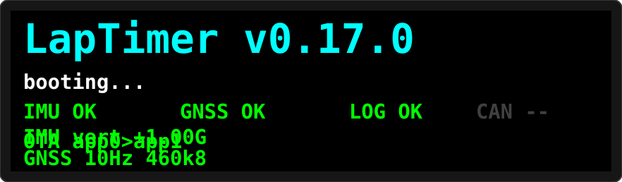 | 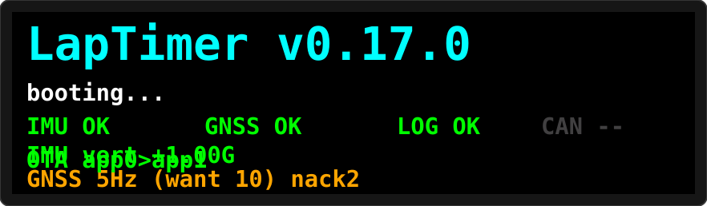 |
| **IMU, GNSS and log failed** | **IMU upside down** |
| 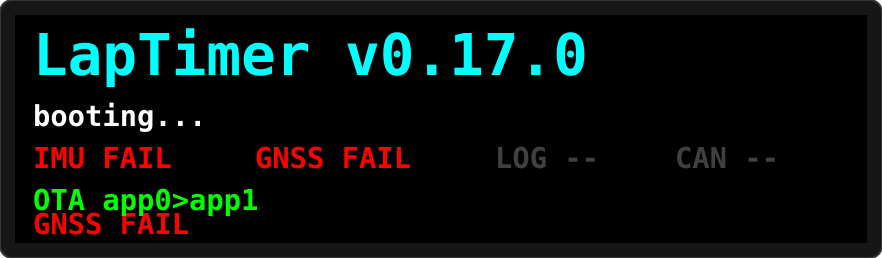 | 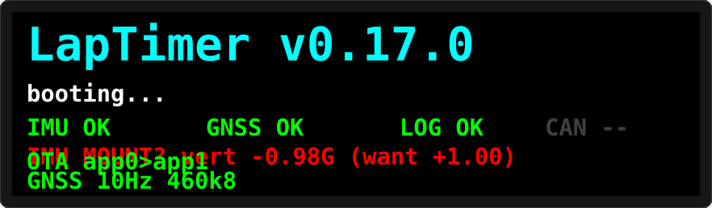 |
| **No second OTA slot** | |
| 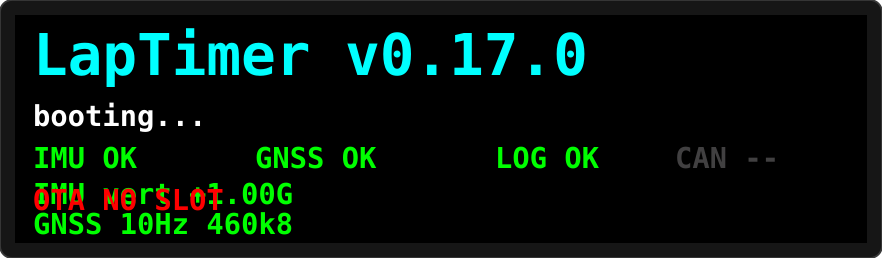 | |

The IMU vertical line (y = 56) and the OTA line (y = 58) are both drawn with a transparent background and overlap by 6 px, so they always print on top of each other. See [findings](#display-findings-in-v0170).

## Boot diagnostic pages (DOWN held at power-on)

Five pages. OK advances. The values come from the boot sequence, so they show what the unit actually negotiated.

| | |
|---|---|
| 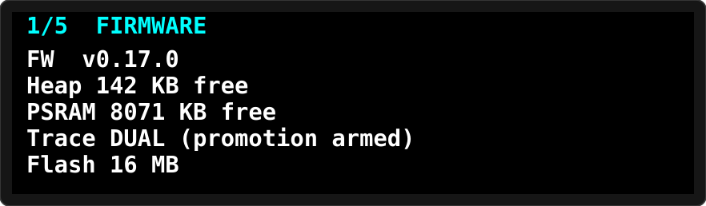 | 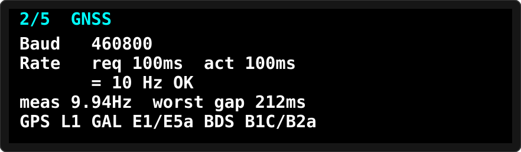 |
| 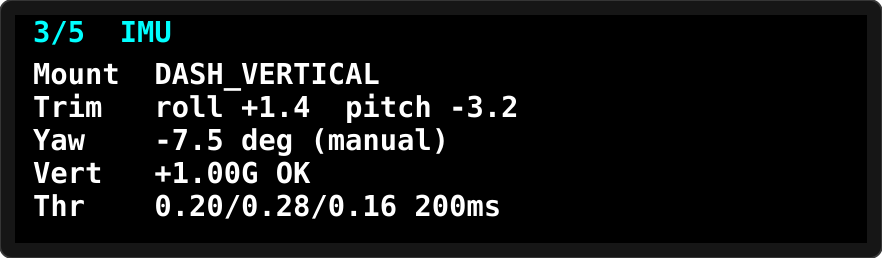 | 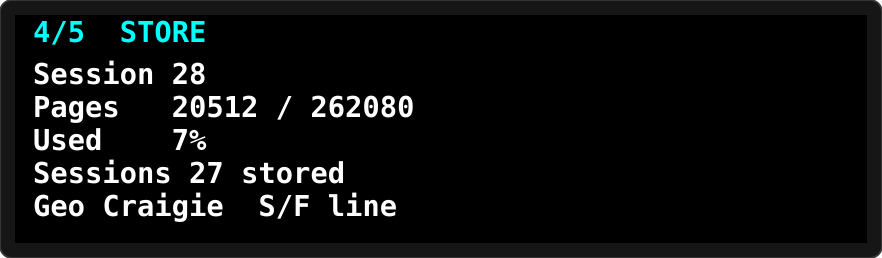 |
| 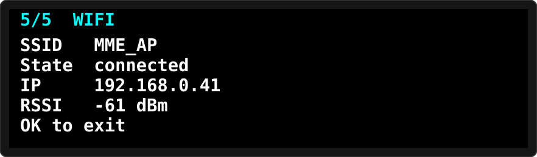 | |

Page 5 prints the compiled SSID (`WIFI_SSID`), not the active one, so it still shows `MME_AP` when NVS credentials point the unit at another network.

## USB export mode (UP held at power-on)

The NAND is presented to a PC as a read-only FAT16 drive (`LOG_nnnn.CSV` files). The unit must be powered through RAW_BATT, because VBUS does not power PLTD v1.0. Holding OK for 5 s erases every log.

| Ready | Erasing |
|---|---|
| 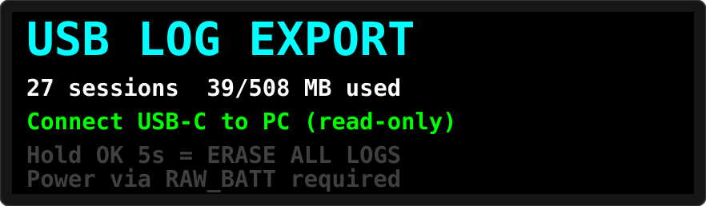 | 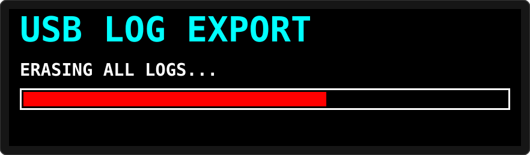 |
| **Firmware built without TinyUSB** | |
| 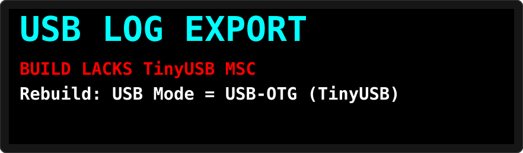 | |

## Idle screen

Shown while the lap state is `LAP_IDLE`. Rows 1–2 are static. Row 3 is the instruction or notice (size 2, 21 characters). Row 4 shows `SAT n PDOP x.x <circuit> S/F:<LINE|PT|NONE>`. Row 5 shows the version and the IP once Wi-Fi is up.

| Circuit armed, waiting for the line | No circuit, no S/F |
|---|---|
| 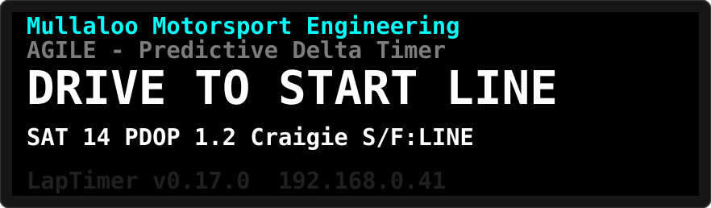 | 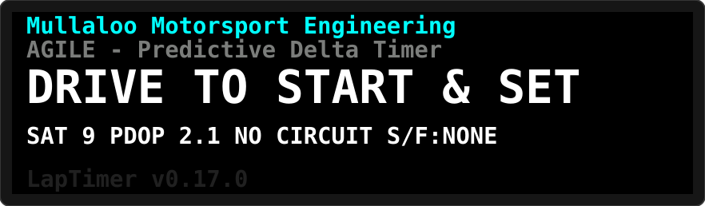 |
| **Legacy point S/F only** | **IMU trim stale** |
| 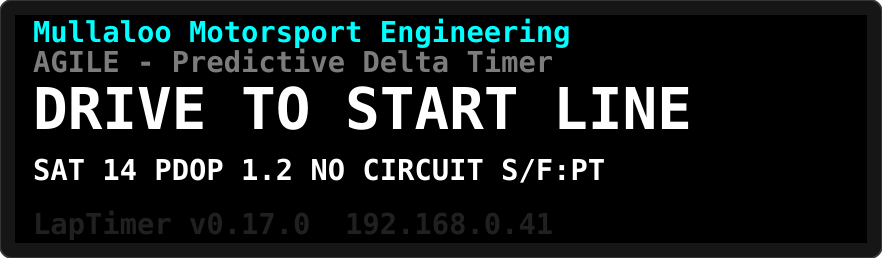 | 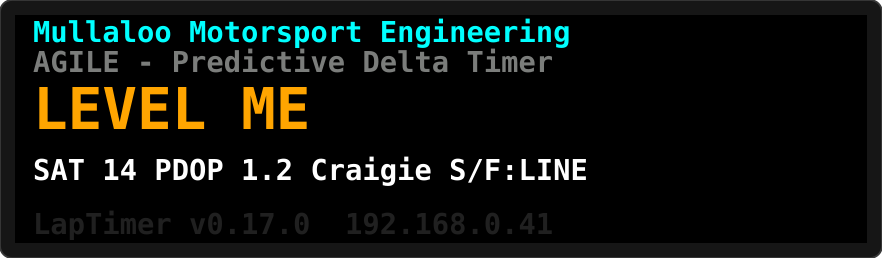 |
| **Stored map offered (within 500 m)** | **Stored map accepted** |
| 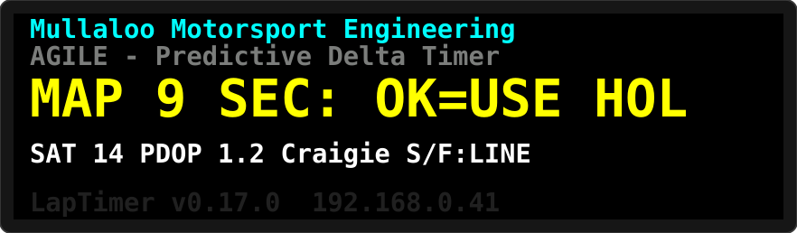 | 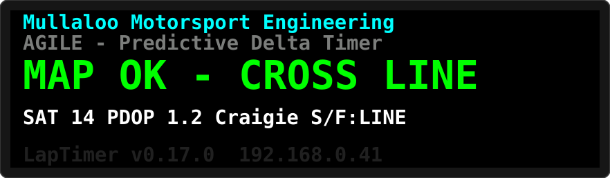 |
| **Recon aborted (stopped > 10 s)** | **Synthesis fell back to 3 sectors** |
| 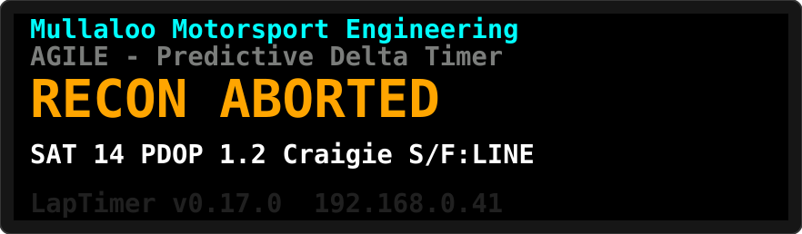 | 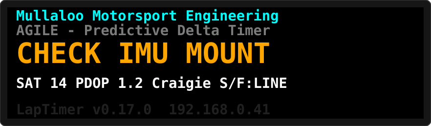 |

Row 3 priority: map prompt > map loaded > recon aborted > check IMU > `LEVEL ME` > `DRIVE TO START LINE` (S/F known) or `DRIVE TO START & SET` (no S/F).

`S/F:` tag: `LINE` = a two-point S/F zone of 8 m or more is armed. `PT` = only the legacy point from a long OK press. `NONE` = no lap can ever trigger.

## Recon lap and approve

The first lap with no stored map is the **recon lap**. The bar is off (centre pip only), there is no estimate, and the strip is one dark slab because no sectors exist yet. At the line, lap 2 starts and the synthesised map is offered for 15 s. OK or no input keeps it. A long OK press redoes the recon. Holding DOWN shows the per-stage synthesis breakdown.

| Recon lap | Approve overlay |
|---|---|
| 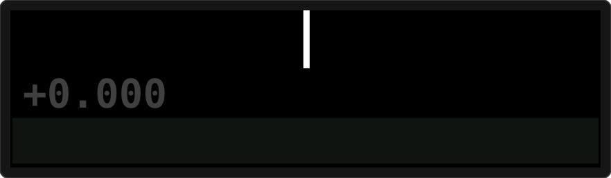 | 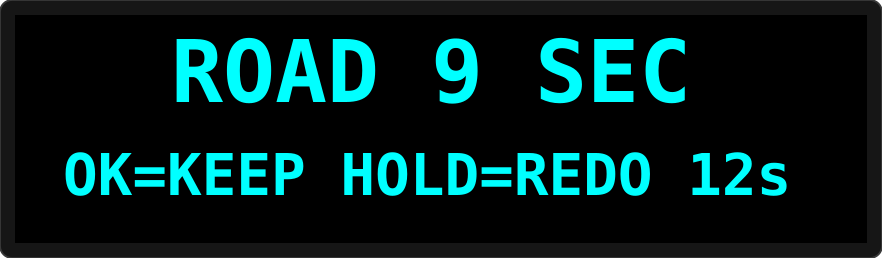 |
| **Synthesis breakdown (DOWN held)** | **SLOW RECON style overflows** |
| 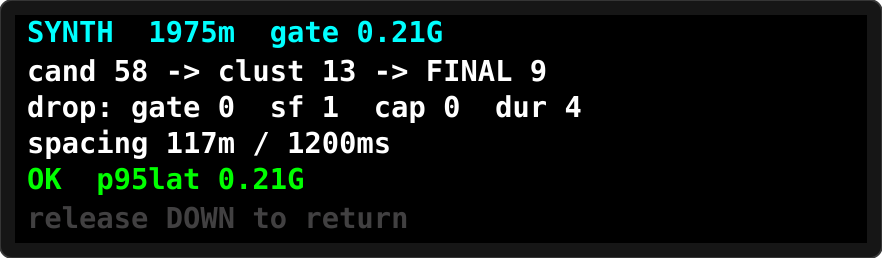 | 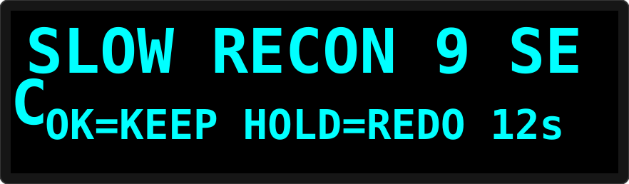 |

The style names are `SLOW RECON`, `ROAD`, `BRISK` and `TRACK` (p95 lateral g < 0.15 / < 0.30 / < 0.60 / above). Line 1 is size 3, so it fits 15 characters. `SLOW RECON 9 SEC` is 16 and wraps onto line 2.

## Racing dash

The racing dash has three bands:

```
y  0–27  DELTA BAR   losing (+) = RED fills LEFT of the centre pip, gaining (−) = GREEN fills RIGHT
                     auto-ranging scale 0.5 / 1 / 2 / 5 / 10 / 20 / 30 s, label top right
                     soft knee: the inner half of each side covers the first 25 % of the scale
y 29–50  INFO ROW    left: cumulative sector delta ±s.mmm   right: predicted lap m:ss.mmm
y 52–73  SECTORS     one block per detected sector (up to 32), sized to fill the width
```

The bar shows the **live lap delta** against the reference lap at the same point on track. It is smoothed with an EMA (0.35 at 20 Hz). The scale grows as soon as the needle would clip and shrinks one step only after 12 s spent below the next step down.

Sector block colours: **green** = faster than reference by more than 10 ms, **red** = slower by more than 10 ms, **gray** = within ±10 ms or not measurable (skipped, too short, out-lap), **dark gray** = not reached yet. The **active** sector is a white block biased to the right when the current sector is being gained and to the left when it is being lost.

| Gaining, 1 s scale | Losing, 5 s scale |
|---|---|
| 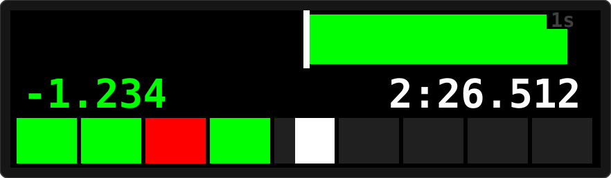 | 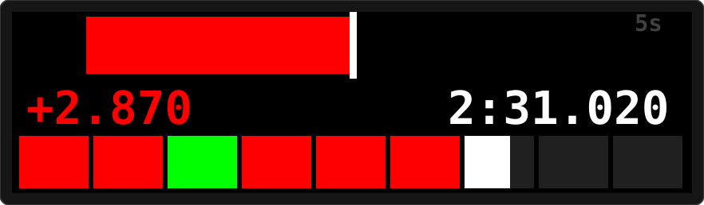 |
| **Small delta, 0.5 s scale** | **All sectors complete** |
| 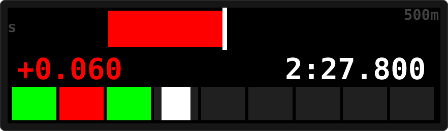 | 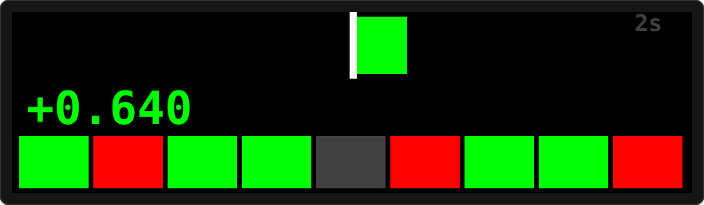 |
| **32-sector circuit, 10 s scale** | **No reference (`BAR_NOREF`, amber box)** |
| 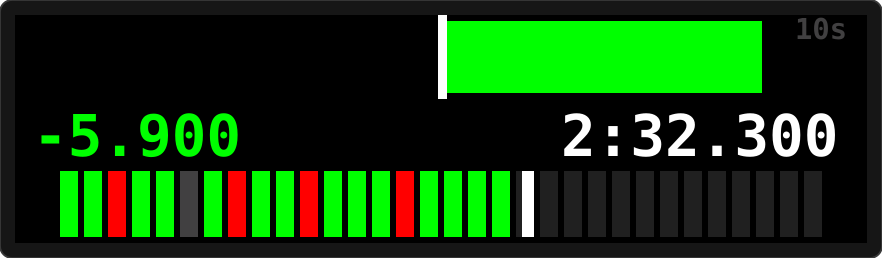 | 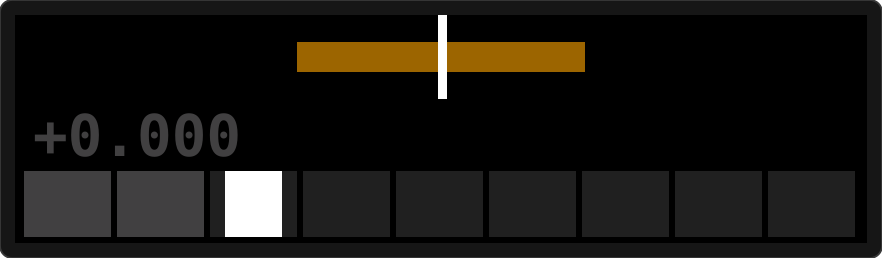 |
| **Active sector too short (`BAR_GRAY`)** | **Out-lap after the pits** |
| 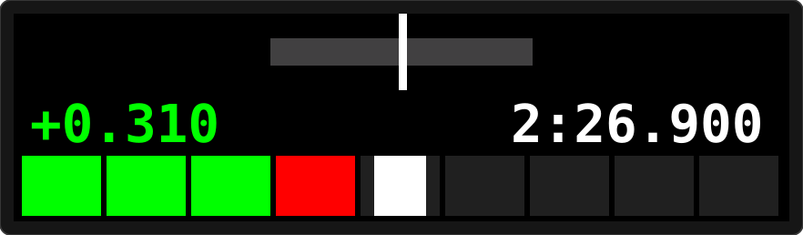 | 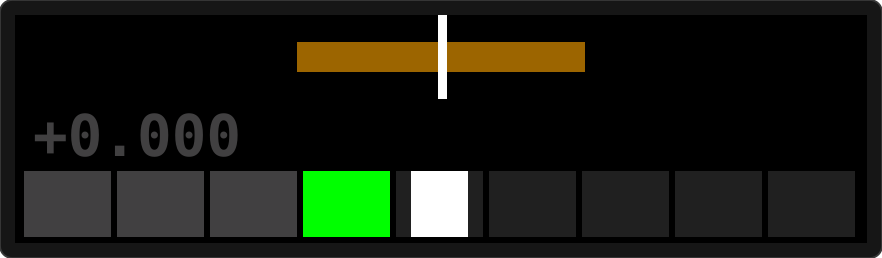 |
| **Cumulative −0.412 s prints as +0.412** | |
| 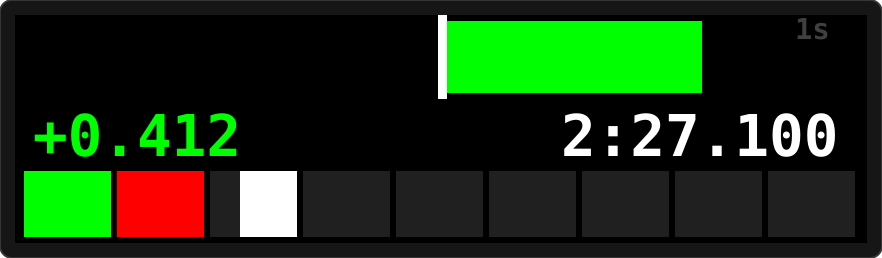 | |

Bar states:

| State | When | Bar |
|---|---|---|
| `BAR_OFF` | not racing (recon lap) | centre pip only |
| `BAR_NOREF` | no reference trace yet, no sectors, delta lost (3+ missed matches), GNSS stale | dim amber box |
| `BAR_GRAY` | the active sector's reference duration is under 2 × the GNSS interval | gray box |
| `BAR_OK` | normal | red/green fill + scale label |

When the car is stationary (under 3 km/h for 2 s) or in the pit lane, the delta stops accumulating. The TFT bar then **holds its last value** (in the pit lane it is hidden behind the car-state screen anyway), while the web bar switches to the amber box because it also checks `timing_live`.

When does each racing scenario happen?

- **Stored map accepted** (OK on the idle map prompt): lap 1 is a racing lap with known sector boundaries but no trace. The bar stays amber until the lap 1 trace is promoted at the line, so the delta arms from lap 2.
- **After a recon lap**: lap 2 races against the recon trace. Any later lap that is faster and did not touch the pits becomes the new reference.
- **Pitted lap**: excluded from best lap and from reference promotion. Sectors stay gray until the car is back on track (`rejoined`).

## Car state and custom zones

Driven by the geofence zones of the armed circuit (see [Pseudocode §10](Pseudocode.md#10-geofence-and-car-state)).

| PIT ENTRY | PITS |
|---|---|
|  |  |
| **FUELLING** | **PIT EXIT** |
| 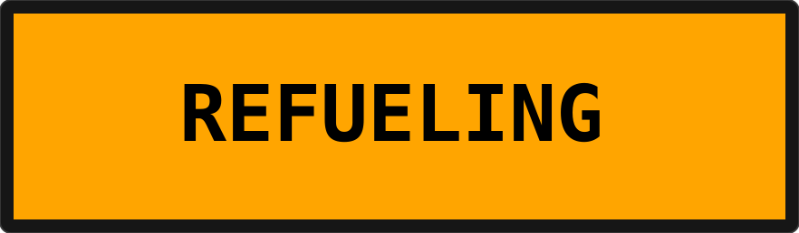 | 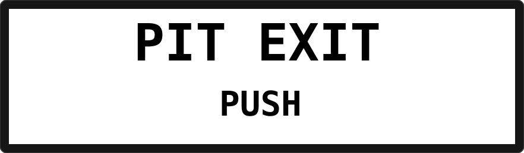 |
| **Custom polygon zone (shows its label)** | |
|  | |

## Pit board messages and flags

Sent from the web Live tab or from PWSM over `/ws`. Request messages (white on blue) clear themselves after 5 s. The three race-control flags stay latched until the engineer lifts them. The driver cannot dismiss either kind.

| PIT REQUEST | PIT NOW |
|---|---|
|  | 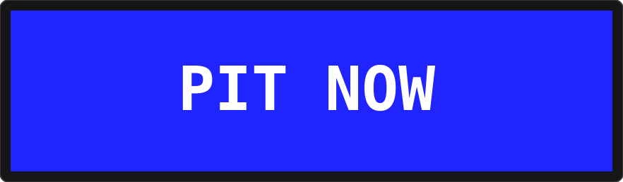 |
| **UPDATE REQ** | **MORE PACE** |
|  |  |
| **LESS PACE** | **YELLOW FLAG (latched)** |
|  | 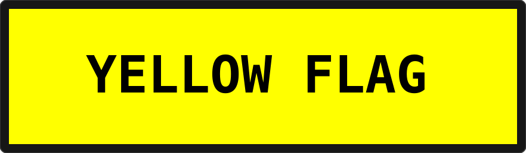 |
| **SAFETY CAR (latched)** | **RED FLAG (latched)** |
|  |  |

With several messages queued (4 slots), the highest priority shows first and the newest wins within a priority. Order: flags (2) > PIT NOW (1) > other requests (0). Any text a client sends through `pitmsg` is shown the same way, up to 15 characters.

## Button hold feedback

Appears once OK has been held for 0.9 s and tells the driver what releasing now will do.

| 0.9–1.2 s | 1.2–10 s | 10 s and more |
|---|---|---|
|  | 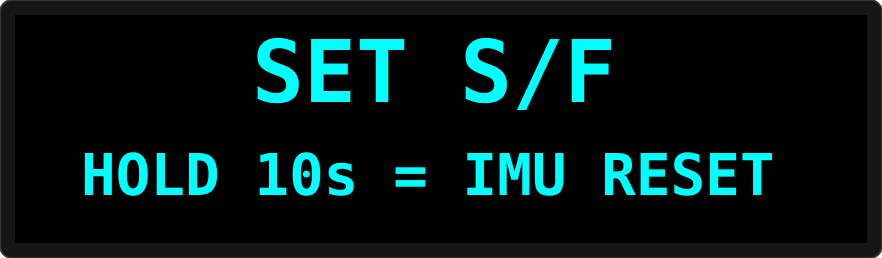 |  |

## Toasts

Short result banners (1.5–2.5 s).

| | |
|---|---|
|  |  |
|  |  |
| 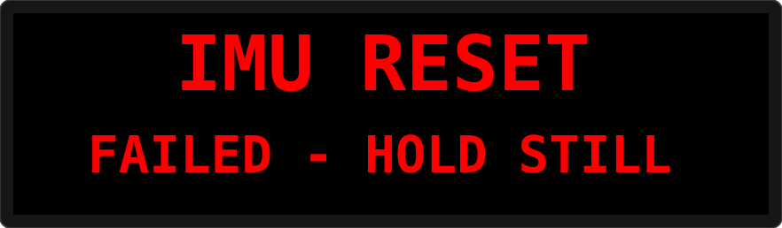 |  |
|  |  |

## Learned-state reset

UP held for 10 s while stopped arms a 5 s countdown. OK cancels it. Letting it run out wipes the sector map, best lap and traces (see [Pseudocode §7](Pseudocode.md#7-laptask-the-main-state-machine)).

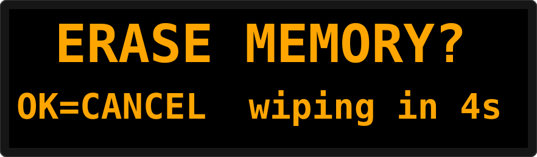

## OTA and reboot

Owner 1, above everything else. Every element is dirty-checked so the SPI bus stays quiet during flash writes. A failure is shown only until the tasks resume, which takes a fraction of a second. Failures before the first byte is written (wrong password, unit moving, no slot) never show this screen.

| Writing | Verified |
|---|---|
| 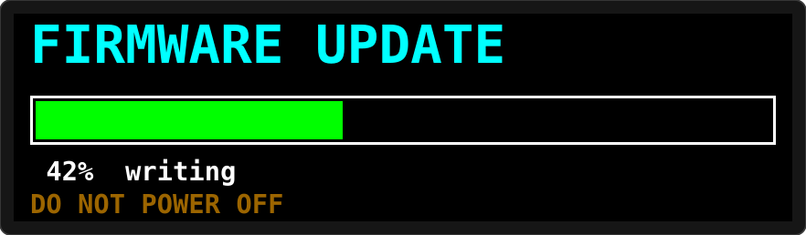 | 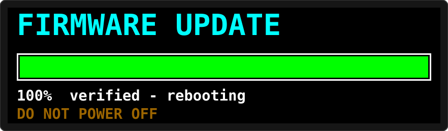 |
| **Failed** | **Web reboot** |
| 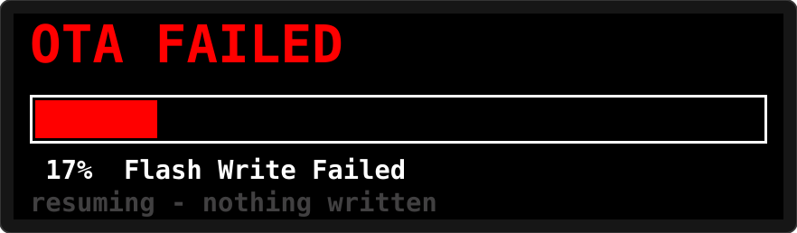 | 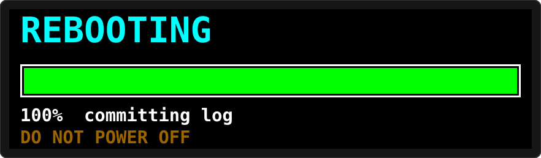 |

## Display findings in v0.17.0

Rendering every path exactly as coded turned up these display problems. None of them affects timing.

| # | Where | Observation |
|---|---|---|
| 1 | `drawInfoRow` | `"%+ld.%03ld"` with `cd / 1000` prints the sign of the integer part, so any cumulative delta between −0.999 s and −0.001 s shows as **`+0.xxx`** (still coloured green). Fix: print the sign from `cd` and format `labs(cd)`. |
| 2 | `drawIdleScreen` | The v0.15.2 prompt `MAP n SEC: OK=USE HOLD=NEW` is 26 characters but the notice field is 21, so the panel shows `MAP 9 SEC: OK=USE HOL`. |
| 3 | `setup()` boot splash | The IMU vertical line (y 56) and the OTA slot line (y 58) overlap. Both are transparent text, so they garble each other on every boot. |
| 4 | Approve overlay | `SLOW RECON n SEC` is 16+ characters at size 3 (15 fit), so it wraps and the last character lands on top of line 2. |
| 5 | Sector colours | Colour 3 (**purple**, personal best) is in the palette and in the web UI, but no code path assigns it. Sectors are only gray, green or red. |
| 6 | Diag page 5 | Shows the compiled `WIFI_SSID`, not the active SSID from NVS. |
| 7 | Car-state comment | The v0.13.0 changelog says PIT ENTRY/EXIT are "white on black"; the code draws black text on a white background (rendered here as coded). |
