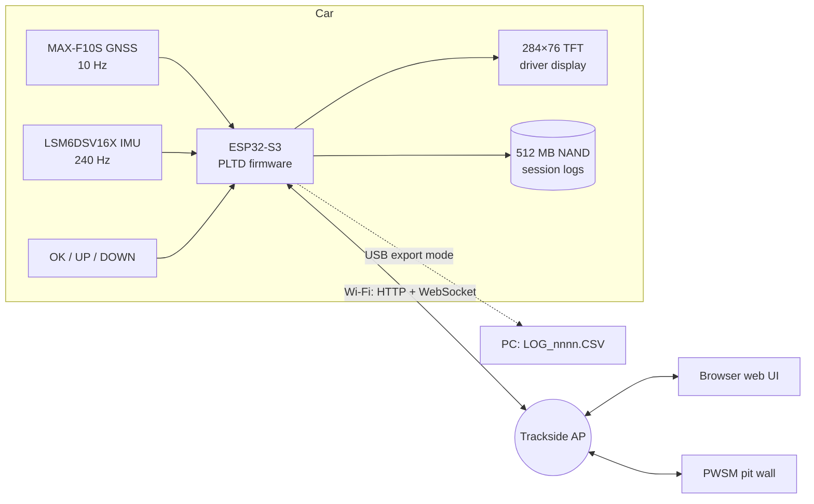
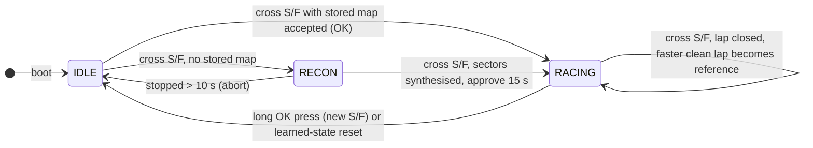
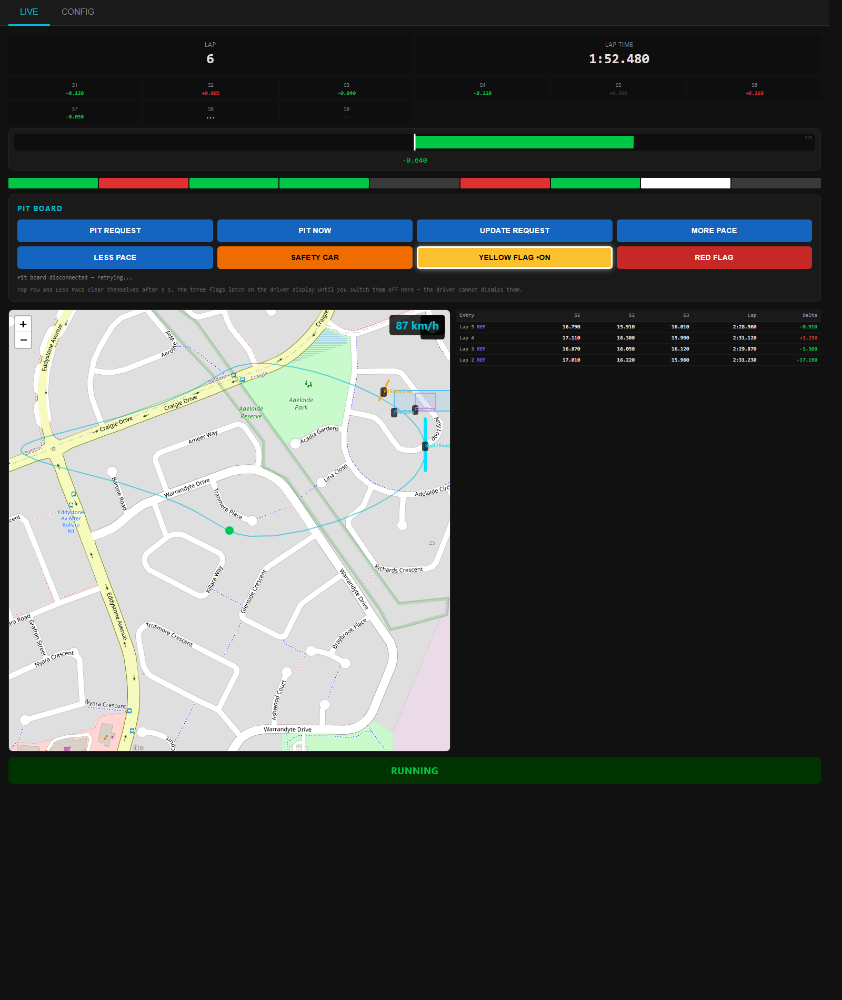
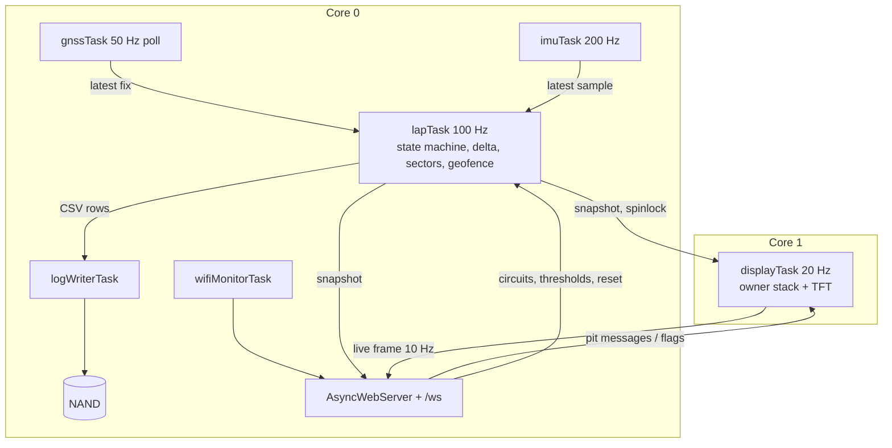

**PLTD: GPS Lap Timer & Driver Display**

GPS lap timer and driver display for circuit racing. PLTD times laps and micro-sectors, records the track outline and the pit lane, fuel bay and pit exit geofences, and shows pit board messages and race-control flags sent from the pit wall on the driver's dash.

Part of the Mullaloo Motorsport Engineering in-car system, alongside [BTTM](https://github.com/redc6t/BTTM) (Brake & Tyre Temperature Monitor) and [CIRTS](https://github.com/redc6t/CIRTS) (CAN Infrared Temperature Sensor). Consumed by [PWSM](https://github.com/redc6t/PWSM_Pit_Wall_Stategy_Manager) (Pit Wall Strategy Manager).


**Features**

- GNSS lap trigger on a start/finish **line** laid across track and pit lane, crossing time interpolated to the millisecond
- Recon lap that builds micro-sectors automatically (up to 32, about one per 150 m)
- Live time delta against the best clean lap, with an auto-ranging delta bar (0.5 to 30 s)
- Geofences for pit entry, pits, fuel bay and pit exit; pit-aware timing (pitted laps never become the reference)
- Pit board messages and latched race-control flags (yellow, safety car, red) the driver cannot dismiss
- IMU (LSM6DSV16X) for sector detection, levelling and GPS-assisted yaw learning
- Append-only NAND session logs, downloadable over Wi-Fi or mounted as a USB drive
- Wi-Fi web app (live view, circuit editor, diagnostics, OTA) plus WebSocket/HTTP API for pit wall clients

**System overview**



**How a session runs**



1. Load a circuit (S/F line plus pit zones) from the web Config tab with **Load to Device**. The idle screen shows the circuit name and `S/F:LINE`.
2. Drive across the line. The first lap is a **recon lap**: the unit records the track and finds braking, cornering and acceleration events.
3. At the line it synthesises the micro-sectors and shows `ROAD 9 SEC  OK=KEEP HOLD=REDO`. Lap 2 is timed against the recon lap.
4. Every faster lap that did not touch the pits becomes the new reference. Pit visits are shown full-screen and are left out of the timing.
5. Next time, parked within 500 m of the same S/F, the unit offers `MAP n SEC: OK=USE`, which skips the recon lap.

| Idle, waiting for the line | Recon approve | Latched yellow flag | Pit lane |
|---|---|---|---|
|  |  |  |  |

Every screen and scenario is in [Documentation/Display.md](Documentation/Display.md).

**Driver controls**

| Input | Action |
|---|---|
| OK short | Keep the new sector map / use the stored map / cancel a pending reset |
| OK hold 1.2 to 10 s | Set a point S/F at the current position and start over |
| OK hold 10 s or more | Level the IMU (car still, level ground) |
| UP hold 10 s, stopped | Erase learned state (map, best lap, traces) after a 5 s countdown |
| UP held at power-on | USB log export mode |
| DOWN held at power-on | Five diagnostic pages |
| DOWN held on the approve screen | Synthesis breakdown |

**Web interface**



Live tab: lap, sectors, delta bar, pit board, map, lap history. Config tab: circuit and zone editor, Wi-Fi, diagnostics, thresholds, logs, IMU orientation, OTA. See [Documentation/WebUI.md](Documentation/WebUI.md) and the API in [Documentation/Interface.md](Documentation/Interface.md).

**Firmware architecture**



Full pseudocode of the firmware: [Documentation/Pseudocode.md](Documentation/Pseudocode.md). Architecture notes: [Documentation/Architecture.md](Documentation/Architecture.md).

**Hardware**

| Component | Part | Interface |
|---|---|---|
| MCU | ESP32-S3-WROOM-1-N16R8 (16 MB flash, 8 MB OPI PSRAM) | - |
| GNSS | u-blox MAX-F10S (GPS L1, Galileo E1/E5a, BeiDou B1C/B2a) | UART1, 460800 baud |
| IMU | ST LSM6DSV16X | SPI (FSPI) |
| Storage | Winbond W25N04KV 4 Gbit SPI NAND | SPI (HSPI, shared with TFT) |
| Display | ST7789 TFT, 284×76 | SPI (HSPI) |
| CAN | TI TCAN3413 (fitted, disabled in firmware) | TWAI |
| Buttons | OK, UP, DOWN | GPIO 8 / 11 / 12 |

Parts as used by firmware v0.17.0. All PCB designs are custom. See [Hardware](Hardware/README.md).

**Repository layout**

```text
PLTD/
├── README.md                 this file
├── Documentation/
│   ├── Architecture.md       block diagram, tasks, timing logic, storage
│   ├── Pseudocode.md         the whole firmware as pseudocode
│   ├── Display.md            every TFT screen and scenario (rendered)
│   ├── Display/
│   │   ├── render_tft.py     regenerates the screens from the firmware's drawing code
│   │   └── screens/*.svg     63 rendered screens
│   ├── WebUI.md              web app, tab by tab
│   ├── WebUI/
│   │   ├── mock_server.py    serves the real web UI against mock data
│   │   └── img/              screenshots
│   ├── Interface.md          WebSocket + HTTP API (PWSM)
│   ├── Flowchart/            state machine diagrams
│   └── Manuals/              driver / pit crew / installation manuals
├── Firmware/
│   ├── PLTD/                 Arduino sketch (PLTD.ino)
│   ├── lib/                  local libraries
│   ├── tools/                partitions.csv, host helpers
│   ├── releases/             tagged binaries
│   └── CHANGELOG.md
├── Hardware/
│   ├── PCB/                  LibrePCB project, schematic and board PDFs, 3D STEP
│   ├── Fabrication/          Gerber, BOM, CPL per revision
│   ├── Enclosure/            Onshape exports
│   └── Datasheets/
└── Photos-Journal_Megadump/  build journal photos
```

| Path | Contents |
|---|---|
| [Firmware/](Firmware/README.md) | Arduino sketch, local libraries, tools, release binaries, firmware changelog |
| [Hardware/](Hardware/README.md) | LibrePCB project, fabrication outputs (Gerber/BOM/CPL), enclosure CAD, datasheets, PCB changelog |
| [Documentation/](Documentation/README.md) | Architecture, pseudocode, display, web UI, pit wall interface, manuals, flowcharts |
| Photos-Journal_Megadump/ | Build journal photos, one folder per milestone |

**Applications**

Designed for circuit racing, track days and motorsport testing, giving entry-level drivers and club teams timing and pit wall communication usually reserved for well-funded teams.

**License**

Code (ESP32 projects): MIT license.

Code (STM32 projects): GPL3.0.

Hardware: cc-by-sa-3.0

By: Pietro Gambarin (pietro.gambarin@gmail.com)
